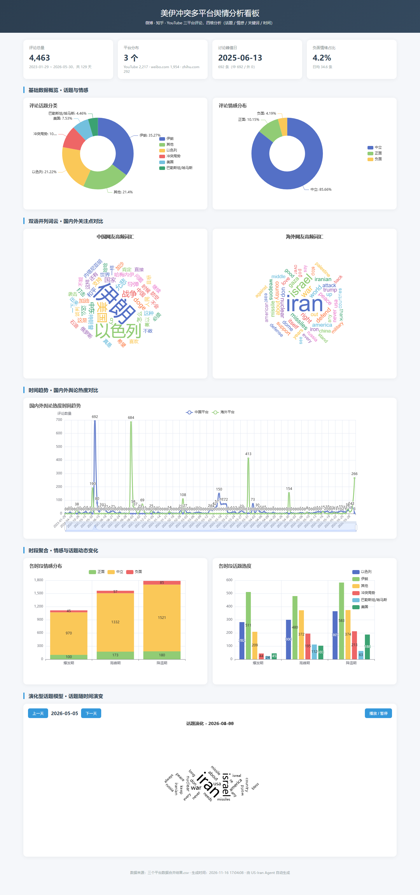

# US-Iran 多平台舆情分析 Agent

把「爬 → 洗 → 合 → 析 → 图」的脚本流水线，改造为一个**由大模型自主编排的 LangChain Agent**。

数据源是微博、知乎、YouTube 三个平台关于美伊冲突的评论；Agent 根据自然语言指令自行决定
「先采集还是直接分析」「要不要重新清洗」「出不出看板」，并输出四维分析结论与可交付的可视化看板。

> 数据与清洗/分析口径来自同目录外的 `US-Iran Conflict` 项目（仅读取复制，未做任何修改）。
> 本项目把原来的 11 个脚本重写为 5 个工具模块 + 1 个 Agent 入口。



*8 个图表面板：话题分布 / 情感分布 / 内外网双语词云 / 时间趋势 / 分期聚合 / 话题演化动态词云。
打开 `outputs/评论分析看板.html` 可交互（悬停看数值、动态词云可播放/暂停/逐日切换）。*

---

## 一、它和「一堆脚本」有什么不同

| | 原来的脚本项目 | 这个 Agent 项目 |
|---|---|---|
| 入口 | 菜单式 `main.py`，13 个调用函数硬编码 | 自然语言对话，`create_agent` + 9 个工具 |
| 调度 | 人按顺序点菜单 | 模型自己规划调用顺序（可跳步、可补跑） |
| 目录 | 输入输出混在一起 | `Comments/` 只放数据，`outputs/` 只放交付物 |
| 状态 | 每次重跑全流程 | 每步都有文件落盘，失败可续跑 |
| 交付 | 直接吐 HTML | 分析结果 JSON + 看板 HTML + Markdown 报告 |

---

## 二、目录结构

```
US-Iran_Agent01/
├─ Comments/                     # 数据区：只读写 CSV，不改结构
│  ├─ weibo/                     #   微博分话题原始 CSV（爬虫产出）
│  ├─ zhihu/                     #   知乎分话题原始 CSV
│  ├─ youtube/                   #   youtube.csv
│  └─ merged/                    #   合并/清洗中间产物（合并版、关键字筛选、三平台总表）
├─ outputs/                      # 交付区：看板 HTML、分析 JSON、Markdown 报告
├─ tools/
│  ├─ __init__.py                # 路径常量、CSV 读写（自动识别 GBK/UTF-8）、工具注册
│  ├─ crawl_tool.py              # 采集：微博 / 知乎 / YouTube（原 crawler_*.py）
│  ├─ clean_tool.py              # 清洗：去重 + 语言比例过滤 + 关键词筛选（原 *_clean.py）
│  ├─ merge_tool.py              # 合并：分话题合并 + 三平台 schema 统一（原 combine*.py / combineAll.py）
│  ├─ analysis_tool.py           # 四维分析：话题 / 情感 / 关键词 / 时间（原 analysis.py 的计算部分）
│  └─ chart_tool.py              # 绘图：ECharts 看板（原 analysis.py 的绘图部分）
├─ main.py                       # LangChain Agent 入口：注册工具、执行调度、交互式 CLI
├─ .env                          # 模型 key + 爬虫 Cookie（不入库）
├─ .env.example                  # 配置模板
├─ requirements.txt
└─ README.md
```

---

## 三、9 个 Agent 工具

| 工具 | 作用 | 读写位置 |
|---|---|---|
| `crawl_weibo` | 微博话题搜索页 → 评论接口，按话题落 CSV | `Comments/weibo/*.csv` |
| `crawl_zhihu` | 知乎搜索接口 → 回答评论接口 | `Comments/zhihu/*.csv` |
| `crawl_youtube` | YouTube 搜索页 + innertube 续页（纯 requests，无 Selenium） | `Comments/youtube/youtube.csv` |
| `merge_platform` | 分话题 CSV 合成单平台合并表，按 id/source_id 去重 | `Comments/merged/*_合并版.csv` |
| `clean_data` | 去重 → 去空 → 语言比例 ≥30% → 关键词命中 | `Comments/merged/*关键字筛选.csv` |
| `merge_all_platforms` | 三平台字段映射到统一 schema 后 concat | `Comments/merged/三个平台数据合并结果.csv` |
| `analyze_data` | 四维分析 + 结构化结果落盘 + 文字摘要 | `outputs/analysis_result.json` |
| `generate_dashboard` | 生成 7 图看板（含可播放的话题演化词云） | `outputs/评论分析看板.html` |
| `save_report` | 把结论写成 Markdown | `outputs/舆情分析报告_*.md` |

统一字段：`website / text_raw / id / screen_name / like_counts / created_at`。

四维分析的口径（与原项目保持一致，便于对照）：

1. **话题**：哈马斯 / 以色列 / 伊朗 / 美国 / 冲突局势 / 其他 —— 词典命中，按优先级判定；
2. **情感**：正负词表计数，正多记正面、负多记负面、相等记中立（可解释，无模型依赖）；
3. **关键词**：中文 jieba 分词、英文正则切词 + 停用词表，取 Top50 做双语词云；
4. **时间**：按天聚合国内外讨论量，并按时间序切「爆发期 25% / 高峰期 35% / 降温期 40%」三段对比情感与话题迁移。

---

## 四、快速开始

```bash
# 1) 安装依赖（Python 3.10+，已在 3.13 验证）
python -m venv .venv
.venv\Scripts\activate          # Windows
pip install -r requirements.txt

# 2) 配置 .env：填 LLM_API_KEY（DeepSeek/通义/OpenAI 均可，OpenAI 兼容协议）
copy .env.example .env

# 3) 进入 Agent 对话
python main.py
```

`.env` 关键项：

```ini
LLM_API_KEY=sk-xxx
LLM_BASE_URL=https://api.deepseek.com/v1   # 换成你的服务商即可
LLM_MODEL=deepseek-chat

WEIBO_COOKIE=...        # 仅重新采集时需要
WEIBO_XSRF_TOKEN=...
ZHIHU_COOKIE=...
YOUTUBE_PROXY=http://127.0.0.1:7897
```

### 关于数据（仓库中不含）

`.gitignore` 排除了 `Comments/**/*.csv`——原始评论含平台用户昵称（`screen_name`）与用户 ID，
不便公开。克隆后补数据有两种方式：

1. 用自己的 Cookie 重新采集：填好 `.env` 后跑 `python main.py --pipeline --crawl`；
2. 把已有的 CSV 按 `Comments/merged/` 下的同名文件名放进去（文件名见 `tools/__init__.py` 常量区）。

不想跑数据也能看效果：`outputs/` 里保留了分析结果 JSON、报告与看板 HTML，双击即可查看。

### 三种用法

```bash
python main.py                                  # 交互对话（推荐）
python main.py --task "分析现有数据并出看板"      # 一次性任务
python main.py --pipeline                       # 不调 LLM，跑确定性流水线（合并→清洗→合并→分析→看板）
python main.py --pipeline --crawl               # 先把三个平台重爬一遍
python main.py --list-tools                     # 查看已注册工具
```

交互模式下可以这样说：

- 「用现有数据跑一遍四维分析，重点看中外舆论差异」
- 「重新清洗微博数据，看看关键词筛选掉了多少条」
- 「基于分析结果写一份 800 字的舆情简报，存到 outputs」
- 「重新生成看板，并告诉我峰值日为什么是那天」

---

## 五、运行产物示例

```
outputs/
├─ analysis_result.json      # 四维分析结构化结果（overview/topic/sentiment/keywords/time/samples）
├─ 评论分析看板.html          # 7 图看板：话题饼图、情感饼图、中英双语词云、时间趋势、
│                            #   分段情感/话题堆叠柱、话题演化动态词云（播放/暂停/逐日切换）
└─ 舆情分析报告_20261116_1653.md
```

看板是单文件 HTML（ECharts 走 CDN，词云插件 echarts-wordcloud），双击即可打开。

---

## 六、实现要点（面试可讲）

1. **工具粒度设计**：每个工具 = 一个可独立重跑、有明确输入输出的步骤，模型才有「跳步/补跑」的空间；
   如果把整条流水线封成一个工具，Agent 就退化成按钮。
2. **错误不抛出、以文本返回**：工具内部捕获异常并返回「未配置 WEIBO_COOKIE，请…」这类可读提示，
   模型拿到提示能自我纠偏（换工具 / 提示用户），而不是 Agent 直接崩。
3. **数据与交付分离**：`Comments/` 是事实来源（只读语义），`outputs/` 是产物，任何一步都可重算。
4. **确定性兜底**：`--pipeline` 不依赖 LLM 也能产出全部交付物，避免「模型抖一下就交不出东西」。
5. **可解释分析**：情感/话题用词典规则而非黑盒模型，指标能被追问「为什么」；关键数字全部来自工具返回，
   系统提示词里明确禁止模型估算。
6. **工程细节**：CSV 编码自动识别（微博是 GBK、其它是 UTF-8-BOM）、HTML 单文件可离线看、
   词云关动画保证多图同页时首帧即渲染。

---

## 七、合规与安全

- 仅采集公开评论，用于学术/作品集分析；请控制频率（脚本默认有 0.8~1.5s 间隔），勿做规模化抓取。
- Cookie 属于个人凭证，只放在 `.env`，不要提交到仓库（已在 `.gitignore` 中忽略）。
- 情感与话题分类是**基于词表的粗粒度判断**，不等同于真实民意，报告中已注明方法论局限。
